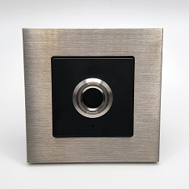

# OAM-AccessControl

OpenKNX Firmware und Anwendung zur OpenKNX-kompatiblen Einbindung von Fingerabdruck- und NFC-Lesern.

## Inbetriebnahme

Die Inbetriebnahme geht am einfachsten mit der [OpenKNX Toolbox](https://openknx.atlassian.net/wiki/spaces/OpenKNX/pages/66295/OpenKNX-Toolbox).

## Kompatible Fingerabdruckleser

Aktuell werden folgende Fingerabdruckleser unterstützt:
- R503 (Speicherkapazität: 200 Finger)
- R503S (Speicherkapazität: 150 Finger)
- R503Pro (Speicherkapazität: 1500 Finger)

Weitere Fingerabdruckleser können bei Bedarf angebunden werden.

## Kompatible NFC-Leser

Aktuell werden NFC-Leser basierend auf dem NXP PN7160 unterstützt.

## Kompatible Hardware

Die kompakte Steuerplatine kann optional vollständig in ein Standard-Schalterprogramm integriert werden. Hier als Beispiel mit Gira-Schalterprogramm in matt schwarz und Edelstahlrahmen:

<kbd></kbd>

Eine Funktionsbeschreibung sowie kompatible Hardware findet sich [hier](https://openknx.atlassian.net/wiki/spaces/OpenKNX/pages/6553602/Zutrittskontrolle).

## Local builds and ESP32 PN7160 support

Use the dependency revisions in `dependencies.txt` for this application's ETS
header. The snapshot now records the currently linked local repositories,
including KNX 2.4.0, Common 1.9.1, LogicModule 4.4.1, ConfigTransfer 0.6,
SwitchActuator 0.3, VirtualButton 0.7 and BinaryInput 0.4. The XML verifies these
module versions. Do not bypass those checks or edit `knxprod.h` to hide a mismatch.

The release ETS application version is 1.0 (encoded as 16, following 0.15), and
the development version is 11.2. SwitchActuator global objects now use numbers
8–10; its channel objects remain at 91–99. Regenerate/import the matching ETS
application when using this firmware. Normal builds use `/tmp/oam-accesscontrol-libdeps`; isolated builds use a
separate project-specific cache under `/tmp`. The R503Pro XML includes the keypad and
feedback definitions referenced by the shared AccessControl description.

The local build helper clones committed local source and the recorded revisions
onto `v1dev_HomeKey`, without switching shared checkouts or pushing. It isolates
PlatformIO's library directory to avoid collisions with other local builds.
`scripts/Build-HomeKey-Local.py` is an optional snapshot-validation helper, not
an ETS generator or a normal build hook. Uncommitted changes are not included.
PlatformIO may download toolchains and third-party libraries. Choose a new build
directory for each snapshot:

```sh
python3 scripts/Build-HomeKey-Local.py --build-dir /tmp/oam-homekey-parity-validation
```

The helper builds these targets by default; use `-e` to select individual ones:

| Target | Configuration |
| --- | --- |
| `debug_RP2040` | Existing RP2040 target and PN7160 implementation |
| `debug_ESP32S3_HomeKey` | XIAO ESP32-S3 with PN7160 I2C and existing access-control features |
| `debug_ESP32S3_PN7160_Peripherals` | ESP32 PN7160 plus fingerprint UART, Gira/matrix keypad, touch/LED expanders, four binary inputs and one bistable relay |
| `debug_ESP32S3_AppleHomeKey` | KNX TP, ESP32 HomeSpan provisioning, DigitalDoorKey and PN7161 I2C module |

Despite its development name, the ESP32 HomeKey target currently uses the legacy
PN7160 protocol and UID-based credentials. Apple Home Key provisioning and
authentication use the separate `debug_ESP32S3_AppleHomeKey` target.

For XIAO Apple Home Key with **KNX IP over Wi-Fi**, select
`debug_ESP32S3_AppleHomeKey_IP`. It uses the same PN7161 I2C pins and private
library checkouts, Arduino 3.3.8/HomeSpan 2.1.8, PSRAM, and current Home Key
startup/diagnostic fixes. The IP target uses internal mask 0x57B0 and reports
0x07B0 for the development ETS product, matching REG1 IP. Its two Home Key
task stacks are 8 KiB each, console ring 2 KiB, web connection limit three,
and web admission limits 16 KiB free internal heap/4 KiB largest block.
The original `debug_ESP32S3_AppleHomeKey` target remains KNX TP. Use:

```sh
~/.platformio/penv/bin/pio run -e debug_ESP32S3_AppleHomeKey_IP
```

The isolated build helper also accepts `-e debug_ESP32S3_AppleHomeKey_IP`;
its default selection remains the four targets listed above.

The ESP32 backend uses the same PN7160 NCI engine, tag detection/removal, UID
enrollment and lookup, ETS action mappings and KNX synchronization as RP2040.
It adds explicit I2C bus/pin selection, 258-byte packet buffers, bounded timeouts
and rejection of incomplete transfers. Invalid UID lengths are rejected on ESP32.
`OPENKNX_ACC_DISABLE_LEGACY_NFC` is no longer set in these targets. The old
RP2040 transport body and platform-specific peripheral operations are retained.

The application links the separately committed local `PN7160` checkout. Its
OGM-Common dependency uses the private checkout at
`../OGM-Common`,
based on upstream revision `f099eb9` (1.9.1) with the logger prefix overflow fix.
The exact revision is pinned in `dependencies.txt`. The shared OGM-Common
development checkout is not used or modified. The ETS configuration uses Common 1.9 and
requires OpenKNXproducer 4.3.12 or newer. The checked-in R503 header was
regenerated from `src/AccessControl-ReleaseR503.xml`.

### REG1-ipTpControllerESP-Devboard v00.11 with PN7161

Choose a target with `pio run -e <environment>`:

| Environment | KNX transport |
| --- | --- |
| `debug_REG1_ESP_PN7161_TP` | TP, mask 0x07B0 |
| `debug_REG1_ESP_PN7161_IP` | KNX IP over Wi-Fi, internal mask 0x57B0, reported mask 0x07B0 |
| `debug_REG1_ESP_PN7161_TPIP` | KNX exclusively over TP, mask 0x07B0; Wi-Fi/IP for Apple Home Key |

`debug_REG1_ESP_PN7161` remains an alias for the TP environment.
TPIP inherits the TP configuration. HomeSpan manages its Wi-Fi connection for
HomeKit/Home Key; KNXnet/IP tunneling and routing are disabled. Wi-Fi connection
changes do not restart the KNX TP stack. Since all REG1 targets enable Home Key,
the TP and TPIP environments currently have the same transport configuration.
The development ETS product supports both TP (`MT-0`) and IP (`MT-5`), following
OAM-NeoPixel's single-product pattern. It uses mask `MV-07B0`; the IP firmware
sets `OPENKNX_OVERRIDE_MASK_VERSION=0x07B0` so ETS sees the same compatible mask,
while `MASK_VERSION=0x57B0` still selects the KNX IP stack internally.
Choose the device's medium/line in ETS and flash the corresponding TP or IP
environment; an ETS parameter does not switch the firmware transport. The
environment named TPIP is still TP-only for KNX, not a simultaneous TP/IP router.

Regenerate the development product with the existing **OpenKNXproducer** VS Code
task, or run:

```powershell
& "$env:USERPROFILE\bin\OpenKNXproducer.exe" create --Debug -h include\knxprod.h -o src\AccessControl.knxprod src\AccessControl.xml
```

Import the regenerated 11.2 development product into ETS and rebuild/flash the
matching firmware. Older IP binaries that report mask `0x57B0` do not have this
single-product compatibility setting. The TP-only R503/R503Pro release products
are unchanged.

Apple Home Key is compiled into all three REG1 environments (and the TP alias).
They use the shared `include/knxprod.h` and exclusively use OFM-HomeKey's
PN7161 I2C backend for ECP, provisioning, authentication and optional UID tags.
Use the Home Key ETS application and commissioning steps below; Home Key must
still be enabled and its endpoints explicitly authorized in ETS.

The Wi-Fi targets connect as a station using credentials stored in NVS.
For initial setup, enter `wifi <SSID> <password>` in the local serial console
(`hk wifi <SSID> <password>` also works). This is available immediately, before
ETS configuration or Home Key enablement, and saves the network for KNX IP
startup and HomeSpan. After Home Key starts, network changes run on its worker.
Diagnostic KNX commands cannot change Wi-Fi credentials. The command is listed
in console help. An open network can be selected with `wifi <SSID>`.

Alternatively, provide quoted string build flags `OPENKNX_WIFI_SSID` and
`OPENKNX_WIFI_PASSWORD` in a local environment override, for example:

```ini
[env:local_REG1_IP]
extends = env:debug_REG1_ESP_PN7161_IP
build_flags =
  ${env:debug_REG1_ESP_PN7161_IP.build_flags}
  -D OPENKNX_WIFI_SSID=\"your-network\"
  -D OPENKNX_WIFI_PASSWORD=\"your-password\"
```

Keep credentials out of version control. Wi-Fi connection proceeds without
blocking KNX TP startup. HomeSpan uses the same network for Home Key.
On the TP and TPIP environments, Home Key also needs Wi-Fi for HomeKit
provisioning; use the same console command or a local build override.

These environments use the
REG1 v00.11 hardware definition (KNX UART1 TX GPIO5, RX GPIO37), the RGB
front panel, and a 4 MB flash layout with a 3 MB application, credential storage
and a separate 128 KB `homekey` NVS partition. Flash the factory image to install
the new partition table. Data from the earlier REG1 partition layout is not
migrated; these 4 MB targets have one application slot.
Fingerprint, keypad, relay and binary-input wiring is not configured.

| PN7161 signal | Connection |
| --- | --- |
| DWL | GPIO19 (held low for normal NCI operation) |
| SDA | GPIO21 |
| SCL | GPIO22 |
| IRQ | GPIO14 |
| VEN | GPIO13 |
| VDD | 3.3 V |
| GND | GND |
| VANT | 3.3 V |

The I2C address is 0x28 and the bus runs at 400 kHz. GPIO19/21/22 are shared
with Ethernet RMII, so Ethernet must remain disconnected and disabled with
this wiring. The Home Key reader applies the fixed 3.3 V PMU/TXLDO preset for
VANT=3.3 V, following the [module vendor's supply configuration](https://www.elechouse.com/docs/pn7161/).
Reader operation and phone/watch provisioning require hardware validation.

#### Power supply and startup troubleshooting

Use the board's documented external-power input and supply-selection settings
when the USB-only supply cannot sustain Wi-Fi startup. On the tested v00.11
board, USB-only operation measured approximately 2.9 V on the nominal 3.3 V rail:
serial-only and OpenKNX-only tests stayed running, but enabling Wi-Fi caused the
USB serial connection to disappear. The same Wi-Fi test booted successfully
with external power connected alongside USB. HomeSpan enables Wi-Fi before
Arduino `setup()`, so this supply issue can prevent any application log output.

The [official v00.11 schematic](https://github.com/OpenKNX/OpenKNX-REG1/blob/main/doc/REG1-Controller-ESP/REG1-IpTpControllerESP-Devboard_V00.11.sch.pdf)
shows USB regulator U150 followed by Schottky diodes D150/D151 (1N5819).
Check the loaded ESP32 supply and the documented power routing; do not bypass
diodes, bridge unverified power jumpers or disable brownout protection as a
workaround. The `No core dump partition found` message also appeared in stable
test runs and does not by itself identify the reset cause. The normal IP
environment includes the full application, not the temporary isolation tests.
With external power, the restored full IP firmware was also verified to boot,
join Wi-Fi, serve its web UI and answer serial commands for over two minutes
without restarting. The board was ETS-unconfigured during this test; Home Key
provisioning and NFC authentication were not exercised.

After ETS configuration, a separate `Stack smashing protect failure` during
fingerprint flash initialization was traced to Common's logger: the prefix
`FlashDriver<fingerprint>` exceeds its old 23-byte construction buffer.
The private Common dependency now constructs prefixes as strings; the display
width still uses `OPENKNX_MAX_LOG_PREFIX_LENGTH`. This fix is independent of
the Wi-Fi power issue. Run the native regression against the actual prefix
implementations with:

```powershell
.\test\logger\prefix_test.ps1 -Compiler C:\msys64\mingw64\bin\g++.exe
```

The regression and IP firmware build passed, and the flashed fix passed
configured fingerprint initialization. With browser clients closed, a 95-second
boot test stayed running with about 39.5 KiB free heap after Wi-Fi connected.
The logger fix is included in the pinned private Common dependency revision.

The subsequent web reset was decoded with the matching Windows ELF (SHA-256
prefix `802fa396b`): `operator new` → `std::string::_M_append` →
`Webserver::buildOverviewPage()` at line 290. This is a failed contiguous heap
allocation during overview HTML growth. The overview and Home Key page now
assemble their body in checked 512-byte chunks, avoiding page-sized string
growth and the second response copy. Partial output is discarded with HTTP 503
if allocation fails. ESP32 request bodies/TX frames use checked allocations,
WebSocket RX uses bounded storage, and aborting a streamed response releases
the remaining HTML chunks.

REG1 limits the HTTP/WebSocket pool to three connections and admits requests
only with at least 16 KiB of internal heap left after request-body allocation
and a 4 KiB largest free block. Under pressure the server returns HTTP 503 with
`Retry-After: 5`, closes that connection and prints the free/largest heap sizes.
These are runtime memory limits; flash partition sizes do not add RAM.

REG1 uses a 2 KiB web-console ring instead of 4 KiB, saving 2 KiB of static
RAM. Long log bursts can overwrite older buffered output sooner. Other
profiles keep their existing defaults. The 16 KiB web admission threshold
remains enabled. REG1 reserves 8 KiB each for the Home Key NFC and HAP tasks
instead of 12 KiB, releasing another 8 KiB of heap once both tasks are running.
The NFC task is created after HAP initialization finishes, avoiding overlap of
its idle stack with temporary startup crypto allocations. `hk memory` reports
minimum remaining stack space against the configured size; pairing and actual
Home Key authentication still need on-device stack-margin checks.

Use `hk memory` on the serial console after boot, web access, pairing and a
Home Key authentication. It reports internal free/minimum heap, largest block,
and Home Key task minimum stack headroom. Runtime heap and stack margins
require these on-device exercises before reducing stacks further.

Native fragmented-heap/allocation-failure and stream-cleanup regression:

```sh
c++ -std=c++17 -fsanitize=address,undefined -fno-omit-frame-pointer \
  -Itest/web_memory/stubs -Ilib/OFM-Network/src \
  test/web_memory/response_test.cpp \
  lib/OFM-Network/src/OpenKNX/Network/Webserver/WebResponse.cpp \
  -o /tmp/oam-web-memory-test
/tmp/oam-web-memory-test
```

The regression renders a 12 KiB body with no body allocation above 1 KiB,
injects allocation failures, and verifies HTML byte order, recovery and
deferred file cleanup. The IP firmware build is the firmware validation target.
Configured page loading still needs a device test; the separately reported
PN7161 I2C health-check failures are not explained by this web allocation trace.

Native I2C transport checks (header/payload framing, transfer failures, standby
full-frame NACK retries, timeout/no-replay behavior, IRQ timeout/tick wrap and reset):

```sh
c++ -std=c++17 -DOPENKNX_HOMEKEY_ENABLED -DARDUINO_ARCH_ESP32 \
  -Itest/homekey_i2c/stubs -Ilib/OFM-HomeKey/src -Ilib/PN7161/include \
  test/homekey_i2c/transport_test.cpp lib/OFM-HomeKey/src/Pn7161I2cTransport.cpp \
  -o /tmp/oam-homekey-i2c-test
/tmp/oam-homekey-i2c-test
```

### XIAO ESP32-S3 prototype wiring

These assignments are a prototype configuration, not a validated carrier board.
Confirm physical connections before flashing. KNX requires an external TP
transceiver, and the peripheral profile requires the listed extra components.

| Function | GPIO / connection |
| --- | --- |
| KNX UART1 | TX GPIO43 (D6), RX GPIO44 (D7) |
| PN7160 and shared I2C | SDA GPIO5 (D4), SCL GPIO6 (D5), PN7160 address 0x28 |
| PN7160 control | IRQ GPIO3 (D2), VEN GPIO4 (D3) |
| Onboard programming LED | GPIO21, active low |
| Optional fingerprint UART2 | RX GPIO1 (D0), TX GPIO2 (D1), touch GPIO7 (D8) |
| Optional bistable relay | SET GPIO8 (D9), RESET GPIO9 (D10), active low; external driver required |
| Direct touch/LED and binary-input expander | PCA9554 address 0x21, GPIO namespace 0x01xx |
| External touch/LED expander | PCA9554 address 0x20, GPIO namespace 0x02xx |
| Matrix keypad expander | PCA9554 address 0x22, GPIO namespace 0x03xx |
| Gira keypad | BS8116 address 0x50 and PCA9633 LED driver address 0x62 |

ESP32 expander touch inputs are polled instead of being registered as MCU GPIO
interrupts. Keypad reads temporarily use 100 kHz; the shared bus otherwise uses
400 kHz. The Gira keypad uses ESP32's bounded Wire timeout and backs off while a
device does not ACK. RP2040 retains its existing timeout recovery and interrupts.
The main ESP32 target safely handles an absent fingerprint sensor. Use the
peripheral target for the prototype that connects those devices.

Both ESP32 profiles use the experimental 8 MB partition table with two 3 MB OTA
slots, a 32 KB OpenKNX partition, separate fingerprint/NFC/keypad partitions and
reserved Home Key NVS space. Credential records retain their existing format.
The separate Apple Home Key target implements credential storage; encryption
is not enabled in this development layout. The OpenKNX
partition is kept below 64 KB because the shared persistence code uses 16-bit
slot sizes.

### Validation

Local compile/link checks on 2026-10-09 passed for RP2040, ESP32 PN7160 and the
ESP32 peripheral profile. Native tests passed for initialization, bus selection,
IRQ/VEN, I2C failures, 258-byte packets and the shared NCI engine's reset,
4/7/10-byte UIDs, repeat suppression and tag removal. Scanner/GPIO checks verify
safe operation when hardware is absent and preservation of real pin IDs.

The unchanged RP2040 baseline was built first with the recorded dependency
snapshot. An initial ESP32 attempt failed on the RP2040 driver's Teensy fallback;
the dedicated ESP32 transport resolves that failure. Build libraries are now
isolated because the old shared `/tmp/libdeps` could be replaced by other builds.

No physical reader, fingerprint sensor, KNX traffic or HomeKit tests have been
performed. On-device validation is still needed to confirm timing and wiring.

```sh
python3 lib/PN7160/test/esp32/run.py
c++ -std=c++17 -DARDUINO_ARCH_ESP32 \
  -Ilib/OFM-AccessControl/test/native/stubs -Ilib/OFM-AccessControl/src \
  lib/OFM-AccessControl/test/native/port_test.cpp \
  lib/OFM-AccessControl/src/Fingerprint.cpp -o /tmp/accesscontrol-parity-test
/tmp/accesscontrol-parity-test
```

The default PlatformIO environment on this machine uses Python 3.14 with working
LZMA support. Build the current workspace directly:

```sh
~/.platformio/penv/bin/pio run -e debug_ESP32S3_HomeKey
```

To build a separate snapshot of committed sources:

```sh
python3 scripts/Build-HomeKey-Local.py \
  --build-dir /tmp/oam-homekey-current-validation \
  --pio ~/.platformio/penv/bin/pio
```


## Apple Home Key implementation (ESP32 prototype)

`debug_ESP32S3_AppleHomeKey`, `debug_ESP32S3_AppleHomeKey_IP` and the REG1 environments enable the separately
versioned OFM-HomeKey module, HomeSpan NFC Access provisioning, DigitalDoorKey
authentication, and persistent explicit issuer/endpoint-to-NFC-ID mappings.
REG1 and XIAO both use PN7161 I2C. The existing RP2040 and XIAO ESP32 PN7160
I2C environments retain their reader paths. The Home Key targets exclude the
legacy reader so only one module owns NFC. HomeKit pairing and UID
identification do not authorize a Home Key endpoint; authenticated mapped IDs
reuse the existing NFC action engine on the OpenKNX thread.

```sh
~/.platformio/penv/bin/pio run -e debug_ESP32S3_AppleHomeKey
```

Use `src/AccessControl.xml` and `include/knxprod.h` together for development.
Home Key parameters, communication objects and commissioning controls are
included in the original A6/01 development application, alongside the existing
modules. Home Key firmware remains opt-in via `OPENKNX_HOMEKEY_ENABLED`.
The R503/R503Pro release XMLs remain unchanged and do not include Home Key;
their release generation continues to regenerate the shared header as before.
Regenerate the development header before returning to development builds.

The development application version is now 11.1 (encoded as 177), including
Home Key and Network. Rebuild firmware and download the
matching ETS application; the former A6/02 Home Key product is no longer used.

`scripts/HomeKey-Build.py` is a PlatformIO pre-build hook for Home Key-enabled
targets. It checks that the shared generated header contains all 16
authorization rows with the byte offsets, bit masks and string lengths
expected by the firmware decoder. It does not generate ETS files, choose an
alternate header, or clone repositories.

Generate the development product with OpenKNXproducer 4.3.12 or newer:

```sh
/path/to/OpenKNXproducer create src/AccessControl.xml \
  -h include/knxprod.h -o src/AccessControl.knxprod -d
```

On this Mac the producer generates the header and checks the expanded XML;
ETS product signing is skipped and an XSD is not installed. Generate/sign the
ETS import product with the appropriate producer setup on Windows.

Apple Home Key is a parameter page inside **Zutrittskontrolle**, with an Apple
icon and German context help for every displayed parameter and commissioning
control. It is shown only when **Allgemein > Hardware > NFC Scanner** selects
an NFC scanner rather than **Kein NFC**. The development application also includes OFM-Network's Webserver
and Wi-Fi commissioning parameters. R503/R503Pro release applications remain
unchanged.

### ETS names and endpoint removal

Every Home Key permission row now includes a 32-character **Bezeichnung**.
Imported entries preserve existing names and permissions. **Gerät löschen
(Prog-Modus)** revokes the row's endpoint persistently in the reader and clears
matching ETS rows, including names. It requires programming mode; other devices
and the HomeKit controller are preserved. The active commissioning window is
closed on revocation. Stale lists, missing programming mode and reader storage
failures leave ETS rights intact. Save the project and download the updated
parameters after removal.

The new fields require development application **11.3 / Home Key 0.4** and a
fresh ETS application download. OpenKNXproducer 4.3.12 generates and checks the
header/expanded XML locally; producing the signed `.knxprod` still requires
running the existing OpenKNXproducer task on a machine with ETS installed.
Common remains 1.9.1 and Network remains 0.8 on the original dependency branches.

### Home Key web page

The page uses OAM-NeoPixel Studio-style tabs and cards: **Setup-Code**,
**Apple Home**, and **Status**. It supports keyboard tab navigation and a
stacked mobile layout. The selected tab survives reload through a URL fragment.
Missing ETS commissioning permission and programming-mode requirements are
shown beside the setup form. In Apple Home, a typed code stays in the open page
while commissioning/pairing is blocked; an amber notice explains the required
ETS setting or pairing action. QR codes are hidden immediately when permission
is lost and cleared when leaving the tab. Setup codes are never stored in the
URL or browser storage.

Home Key-enabled REG1 and XIAO targets include the private OFM-Network `v1dev`
checkout with the bounded web-memory fix at `9c46cb8`. Its checkout under the
HomeKey workspace is linked through `lib/OFM-Network`.
Home Key carries its anti-CSRF
token and setup codes in a bounded POST body, not custom headers or URLs.
Wi-Fi serves the web UI and HomeSpan even on
KNX TP targets; it does not change the selected KNX transport.
The REG1 TP/IP and XIAO Apple Home Key IP debug targets use `-Og` with full debug information to keep
KNX IP, Home Key and the web UI inside the existing 3 MB application slot;
the flash partition layout is unchanged.

Enable **Netzwerk > Webserver** in ETS, then open the device's IP address in a
browser. The standard **Übersicht** and **Gerätekonsole** pages use
OFM-Network's built-in implementations, like OAM-NeoPixel. The web group monitor,
file manager/upload and NeoPixel-specific pages are not included.
Choose **Home Key** for its setup-code form, using the same OpenKNX navigation,
layout, typography and status table. To save a setup code:

1. Enable Apple Home Key and NFC commissioning in ETS and download the application.
2. Activate programming mode.
3. If a code is already stored, enter that existing code. Enter the new private
   eight-digit setup code twice and select **Setup-Code speichern**.
4. Wait for the persisted-save confirmation, then deactivate programming mode.

Repeated digits and `12345678` / `87654321` are rejected. The page never reads
back the code. Saving runs on the HomeSpan worker and closes any earlier pairing
window; it does not open a new window or grant access. Disabled ETS commissioning,
table unload, or loss of programming-mode permission cancels pending changes.
Replacement is verified against the stored code on the HomeSpan worker, including
console requests (`hk code <new8digits> <old8digits>` or
`hk pair <new8digits> <old8digits>`). Only first initialization accepts no old code.
Five incorrect attempts block changes for five minutes. The failure counter
persists; reboot restarts an exhausted cooldown instead of clearing it.
Successful authentication clears the counter. `hk reset` does not erase the
setup code or provide a way around the old-code check.
Requests use a per-boot anti-CSRF token. There is no web login or HTTPS; use only
a trusted network. Programming mode can also be switched from OpenKNX's web UI
and is not a physical-presence authentication mechanism.

**Development security limitation:** web administration authentication has been
deferred. The standard console permits commands and broadcasts their text to
connected consoles; do not enter Wi-Fi passwords or setup codes there. Prefer
the Home Key form for code changes. Console reset/flash commands can bypass
application-level protections.
Requiring the old code does **not** make these web tools safe on an untrusted
network. Keep the webserver disabled except for supervised commissioning.
A separate, user-configurable web administrator password and physically
authorized first-use password setup are not implemented yet.

To add the accessory in Apple Home, open the pairing window in ETS, then enter
the current setup code under **In Apple Home hinzufügen** on the Home Key page.
Scan the displayed QR with the iPhone camera or Apple Home's **Add Accessory**
scanner; both devices must be on the same network. The QR uses a HomeKit
`X-HM://` payload, lock category and IP pairing, with a stable MAC-derived
four-character setup ID also configured in HomeSpan. QR generation runs entirely
in the browser using locally served qrcode-generator 2.0.4 (MIT); no external
service receives the code. This input is not checked against the saved code:
an incorrect code cannot pair. No saved code is read back. The QR contains the
entered code; keep it private. It is cleared when hidden, on page exit, on
connection loss, or when polling reports commissioning closed/code changes
pending. Apple Home pairing alone does not grant door access.

On Windows, install OpenKNXproducer 4.3.12 or newer at
`%USERPROFILE%\bin\OpenKNXproducer.exe`. In VS Code, select **Terminal > Run Task >
OpenKNXproducer**. This generates `src/AccessControl.knxprod` for ETS import
and refreshes `include/knxprod.h`, including the Home Key definitions.
Rebuild development firmware after regenerating its header.

The equivalent PowerShell command, run from the project root, is:

```powershell
& "$HOME\bin\OpenKNXproducer.exe" create --Debug `
  -h include\knxprod.h -o src\AccessControl.knxprod `
  src\AccessControl.xml
```

Configure Wi-Fi from the local serial console with `wifi <SSID> <password>`
before ETS setup if needed. Enable Home Key and commissioning in its ETS
parameters, then set a private HomeKit code locally using `hk code <8digits>`.
Use the ETS parameter-page buttons to open/close the
five-minute pairing window and refresh its status. The buttons use the device's
individual address through the ETS KNX interface. Pair in Apple Home with the
locally configured code; KO 12/13/64 remain available for Group Monitor control.

Enable the ETS authorization table, then press `Provisionierte Geräte-IDs
importieren`. The script adds full public issuer/endpoint IDs to completely
empty rows, preserves existing rows and rights, and leaves new rows disabled.
Assign unused NFC action IDs 0..1499, configure the corresponding NFCACT actions,
enable the rows and download. Importing IDs alone grants no access. The script
checks snapshot consistency and available capacity before writing. KO 14 reports
table validity, pending endpoints and UID collisions. Local `hk map` /
`hk unmap` is available when ETS authorization is off. An invalid/empty ETS
policy cannot use a saved local mapping as fallback.

The Home Key application/header is now version 0.4 and the development
application is 11.3. Regenerate and use the matching ETS product for this
firmware. All existing RP2040/legacy applications
retain their versions, parameters and object numbers. Full object/status tables,
commissioning, retention and revocation details are in
[OFM-HomeKey/Readme.md](lib/OFM-HomeKey/Readme.md).

Both XIAO Apple Home Key targets use the PN7161 I2C module with this wiring:

| PN7161 | XIAO pin | ESP32-S3 GPIO |
| --- | --- | --- |
| DWL | D1 | 2 |
| SDA | D4 | 5 |
| SCL | D5 | 6 |
| IRQ | D2 | 3 |
| VEN | D3 | 4 |
| VDD | 3V3 | — |
| VANT | 3V3 | — |
| GND | GND | — |

The address is 0x28 at 400 kHz. Both select `HOMEKEY_READER_I2C` and the
`HOMEKEY_PN7161_VANT_MV=3300` power preset; DWL is held low from application setup.
The optional fingerprint/relay profile conflicts with these control pins and
cannot be combined with Apple Home Key. Lock feedback uses KO 11
(1=physically locked). Home app remote unlock is not enabled.

REG1 TP/IP/TPIP already select the same I2C transport and 3.3 V preset, using
SDA21/SCL22/IRQ14/VEN13/DWL19. The earlier SPI selection affected only the XIAO
Apple Home Key targets. SPI-target binaries produced before this correction
must be replaced before connecting the I2C reader.

The four XIAO environments (`debug_ESP32S3_HomeKey`,
`debug_ESP32S3_PN7160_Peripherals`, `debug_ESP32S3_AppleHomeKey`,
`debug_ESP32S3_AppleHomeKey_IP`) locally pin
PioArduino 55.03.38-1 (Arduino 3.3.8 / ESP-IDF 5.5.4) through their shared
HomeKey environment. The OGM-Common ESP32 platform selection and RP2040
configuration are unchanged. HomeSpan is pinned to 2.1.8. The original three
profiles compiled and linked successfully with this platform pin on 2026-10-09.
The XIAO Apple Home Key IP target was built and its effective IP/PSRAM flags
verified on 2026-11-03 using OFM-HomeKey `0edf05c` and OFM-Network `9c46cb8`.
This is compile/link validation; physical NFC, Wi-Fi and HomeKit operation
on the XIAO still require device testing.

The Arduino-only integration builds without an IDF project conversion. Exact
local wrapper revisions are recorded in `dependencies.txt`; HomeSpan 2.1.8 is
pinned in the environment. Modified dependencies, including OFM-HomeKey, are
checked out under `..` and linked from
`lib`. Each library has its own Git checkout in `HomeKey/<library-name>`.

Home Key upstream dependencies were checked on 2026-10-30:

| Dependency | Selected upstream revision | Status |
| --- | --- | --- |
| HomeSpan | [2.1.8 / 107ffc0](https://github.com/HomeSpan/HomeSpan/releases/tag/2.1.8) | Latest stable release; existing pin retained |
| DigitalDoorKey | [80e4a1e](https://github.com/rednblkx/DigitalDoorKey/commit/80e4a1e14eab3646b62ab3bdad6d2ed01d399375) | Updated Arduino wrapper; crypto shim moved to public includes |
| PN7161 driver (`rednblkx/pn7160`) | [db5cb56](https://github.com/rednblkx/pn7160/commit/db5cb56b2ccfbaa4c30879043a3597bd6c7d53c8) | Current upstream; existing wrapper retained |

The updated DigitalDoorKey wrapper lives in
`../DigitalDoorKey` and is linked through `lib/DigitalDoorKey`.
Its exact local revision is pinned in `dependencies.txt`.
The local OFM-HomeKey implementation retains its PN7161 I2C, Wi-Fi console and
commissioning changes. Other OpenKNX dependencies were not updated.

The Home Key implementation and its ESP32 integration changed these repositories:

| Repository | Changes |
| --- | --- |
| OAM-AccessControl | Build environments, board wiring, flash partitions, ETS integration, startup and regression checks |
| OFM-HomeKey | HomeKit provisioning, authentication, authorization mappings, ETS commissioning, PN7161 I2C transport and Wi-Fi console/help |
| OFM-Network | Bounded ESP32 web response allocation and low-memory handling |
| OGM-Common | Logger prefix overflow fix |
| OFM-AccessControl | ESP32 credential storage/peripherals and guarded Home Key/externally owned NFC adapter |
| DigitalDoorKey | Arduino/PlatformIO wrapper and SDK crypto/header integration |
| PN7161 (`rednblkx/pn7160`) | Distinct Arduino/PlatformIO SPI/NCI driver wrapper; the I2C transport is in OFM-HomeKey |
| PN7160 (`Strooom/PN7160`) | ESP32 I2C port for the legacy reader environments, preserving RP2040 behavior |
| OFM-SwitchActuator | Console diagnostic API compatibility fix used by the integration |
| OFM-FileTransferModule | Conditional gzip compiler-warning fix in the earlier Home Key integration; current checkout uses the upstream `ec/v1dev` branch |

HomeSpan is used without source modifications. OGM-Common uses the private
repository with the logger prefix overflow fix. OGM-HardwareConfig,
LogicModule, BinaryInput, VirtualButton and ConfigTransfer use their existing
upstream checkouts. `dependencies.txt` records the actual local revisions used
by the verified builds, including the current KNX stack checkout.

### Private Home Key development repositories

The application and modified dependencies are maintained as independent private
repositories under `u20p17`:

| Repository | Purpose |
| --- | --- |
| [OAM-AccessControl](https://github.com/u20p17/OAM-AccessControl) | Application and build configuration |
| [OGM-Common](https://github.com/u20p17/OGM-Common) | Logger prefix overflow fix |
| [OFM-HomeKey](https://github.com/u20p17/OFM-HomeKey) | Home Key implementation |
| [OFM-Network](https://github.com/u20p17/OFM-Network) | Web server and memory-pressure fixes |
| [OFM-AccessControl](https://github.com/u20p17/OFM-AccessControl) | Access-control integration |
| [DigitalDoorKey](https://github.com/u20p17/DigitalDoorKey) | Arduino authentication wrapper |
| [PN7161](https://github.com/u20p17/PN7161) | PN7161 NCI driver wrapper |
| [PN7160](https://github.com/u20p17/PN7160) | Legacy ESP32 I2C reader port |
| [OFM-SwitchActuator](https://github.com/u20p17/OFM-SwitchActuator) | Compatibility changes |
| [OFM-FileTransferModule](https://github.com/u20p17/OFM-FileTransferModule) | Firmware/file-transfer dependency |
| [knx](https://github.com/u20p17/knx) | KNX stack branch used by this application |

Most private dependencies use `v1dev_HomeKey`; OFM-Network uses `v1dev` and
OFM-HomeKey's web-memory fix uses `fix/esp32-web-memory`. The exact branch and
commit for every dependency are recorded in `dependencies.txt`. The
local `origin` points to the private repository and is the default push remote.
Where a public source exists, it is retained as `upstream` for fetching, with
its push URL disabled (`no_push://public-upstream-disabled`). Existing shared
OpenKNX checkouts retain their original remotes. GitHub Actions is disabled on
the private repositories; no collaborators were added. `dependencies.txt`
records the private clone URLs and exact revisions of modified dependencies.

The ten private dependencies are checked out directly from GitHub in
`..`. Application library links use
relative paths such as `lib/OFM-Network -> ../../../HomeKey/OFM-Network`.
`AccessControl.code-workspace` opens these active library links so the editor
shows the same checkout that PlatformIO builds.

The dependency checkouts are linked from `lib`. Do not replace those links with public upstream
clones: the committed local wrappers are required. The isolated build helper
copies all recorded local dependencies and now builds all four targets.
Generated package caches use a project-specific `/tmp` directory because files
in the synced project cache acquired duplicate source copies during builds.

This is the first software prototype. Physical PN7161 operation, Home Key
provisioning/taps on iPhone or Watch, RF timing and concurrent KNX traffic have
not been verified. NVS encryption, secure boot and production commissioning
hardening remain for the next hardware/security stage.

Validation on 2026-10-09: all four environments compiled and linked; the new
ETS header passed producer consistency checks; native Home Key persistence,
revocation, policy and online protocol tests passed. ETS JavaScript tests cover
safe imports, commissioning and the actual Common wrapper with small APDUs.
Live ETS buttons and physical KNX/Home Key operation still require validation.
Home Key firmware occupies about 2.79 MB of its 3 MB OTA slot (88.8%); static
RAM is about 74 KB (22.6%). The SDK size-report helper emits a nonfatal `--ng`
option warning; PlatformIO's firmware size check and image generation succeed.

The Apple Home Key target also compiled and linked with HomeSpan 2.1.8 and
PioArduino 55.03.38-1 on 2026-10-09; no integration code changes were needed.
Pairing/provisioning on physical hardware remains unverified.
