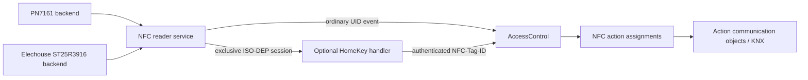

# Elechouse ST25R3916 integration plan

Status: initial I2C backend implemented after the research below. The user
confirmed **Elechouse ST25R3916, already configured for I2C**. SPI is not the
selected implementation. See the implementation status at the end.
Source inspection: 4 November 2026.

The preceding fixes were committed separately before this research:

| Private u20p17 checkout | Commit | Change |
| --- | --- | --- |
| OFM-HomeKey | `f3f68bf` | PN7161 read recovery and authorization diagnostics |
| OFM-AccessControl | `0f0b403` | NFC action bounds, slot 0 and quiet information probes |
| OFM-SwitchActuator | `b9988a8` | Zero-channel flash write size |
| OAM-AccessControl | `6540294` | Integration, dependency references, ETS 11.4 and tests |

These are local commits; nothing was pushed. This plan was written afterward.

## Findings

**HomeKey-ESP32 is a useful reference, rather than a firmware replacement.**
Inspected revision: `f167cba1950aa9e37afb9cb06163a78299599a67`.
Its ST25R3916 reader implements the same `INfcReader` interface as our copy
(only trailing whitespace differs). It includes NFC-A selection, UID cascade
handling, RATS/ATS, ISO-DEP framing, chaining/recovery, WTX handling, presence
checks and raw ECP transmission. Its reference hardware is the M5Stack Unit NFC,
I2C address 0x50, hardware I2C at 400 kHz, with register polling instead of an IRQ
wire. It is development support; no claim of validation on our Elechouse board
or OpenKNX firmware follows from those tests.
[Reader interface and board assumptions](https://github.com/rednblkx/HomeKey-ESP32/blob/f167cba1950aa9e37afb9cb06163a78299599a67/main/include/St25r3916Reader.hpp),
[implementation](https://github.com/rednblkx/HomeKey-ESP32/blob/f167cba1950aa9e37afb9cb06163a78299599a67/main/St25r3916Reader.cpp).

**The Elechouse board changes the transport choice.** Its documented default is
SPI, with MOSI/MISO/SCK/CS/IRQ plus 5 V power and ground. I2C requires bridging
the board's I2C pad. SPI + IRQ is the recommended first target. The vendor's
generic ESP32 pin table is not an approved REG1 or XIAO wiring assignment;
those need separate pin checks. Chip supply/interface details must not be
confused with the board's 5 V power input.
[Elechouse board documentation](https://www.elechouse.com/docs/st25r3916/),
[interface selection](https://www.elechouse.com/product/st25r3916_nfc_reader/).

**Prefer the vendor/ST RFAL stack for the Elechouse backend.** Its Arduino
packaging provides `ST25R3916_ELECHOUSE` and `NFC-RFAL`, including an SPI/IRQ
polling example. Inspected vendor revision:
`76d85da7b7e9cb89042eb0e31e070fec91030abb`. Wrap RFAL in `INfcReader`; use
HomeKey-ESP32 as the reference for ECP sequencing and connecting APDU exchange
to DigitalDoorKey. Do not run RFAL and the reference's custom ISO-DEP state
machine simultaneously on the same chip.
[Vendor SPI polling example](https://github.com/wilson-elechouse/ST25R3916/blob/76d85da7b7e9cb89042eb0e31e070fec91030abb/ST25R3916_ELECHOUSE/examples/SPI/ESP32_SPI_polling_hotplug/ESP32_SPI_polling_hotplug.ino).

This preference is an engineering recommendation: RFAL supplies the radio and
ISO-DEP machinery for this board, while HomeKey-ESP32 proves a useful integration
shape. It still needs an ECP/raw-transceive proof and a measured memory budget.
If the RFAL configuration cannot fit, evaluate a separate, lean SPI/IRQ port of
the reference driver behind the same interface. Do not silently switch stacks.

The reference application now requires IDF >=5.5.5 / Arduino 3.3.11; our current
target uses Arduino 3.3.8 / IDF 5.5.4. Importing that entire application's build
would be a separate migration. Start by compiling only the chosen backend and
its required RFAL features on our pinned toolchain.
[Reference build requirements](https://github.com/rednblkx/HomeKey-ESP32/blob/f167cba1950aa9e37afb9cb06163a78299599a67/main/idf_component.yml).

Retain the reference's MIT notices if code is reused. The vendor RFAL packages
carry ST's SLA0052 terms, including use with ST NFC ICs; keep those notices and
the ST backend dependency isolated from PN-only builds.
[Reference license](https://github.com/rednblkx/HomeKey-ESP32/blob/f167cba1950aa9e37afb9cb06163a78299599a67/LICENSE),
[RFAL license](https://github.com/wilson-elechouse/ST25R3916/blob/76d85da7b7e9cb89042eb0e31e070fec91030abb/NFC-RFAL/LICENSE).

## Current PN7161 behavior

| Question | Current implementation |
| --- | --- |
| Can the hardware read ordinary NFC tags without HomeKey? | Yes. HomeKey is an application using the reader, not a requirement of the reader. |
| Can ordinary tags and HomeKey share the reader now? | Yes, in a HomeKey-enabled target with HomeKey active and `Konventionelle UID-Tags zulassen` enabled. |
| Does setting HomeKey to Nein leave ordinary scanning running in our current PN7161 HomeKey targets? | No. The worker is gated by HomeKey `enabled`, HAP `provisioningReady` and credential-store health; the legacy reader is excluded in these targets. |
| Is ECP already implemented for PN7161? | Yes, through proprietary NCI configuration parameter `0xA06C`. |
| Is the older PN7160 path replaced globally? | No. Ordinary legacy builds still have their own PN7160-oriented reader path. |

Relevant local sources:

- `lib/OFM-HomeKey/src/HomeKeyModule.cpp`: owns/starts the reader task and
  constructs the ECP buffer from the stored 8-byte group identifier.
- `lib/OFM-HomeKey/src/HomeKeyAuth.cpp`: classifies a HomeKey SELECT separately
  from ordinary tags; failed HomeKey authentication never becomes a UID grant.
- `lib/OFM-HomeKey/src/Pn7160Reader.cpp`: writes ECP configuration during init
  and stops/reconfigures/restarts discovery on `updateECP()`.
- `platformio.custom.ini`: PN7161 HomeKey targets exclude the legacy owner.
- `lib/OFM-AccessControl/src/AccessControl.cpp`: ordinary UID enrollment,
  storage, slot reservations, action routing and KNX output.

For ECP, the current HomeKey worker builds 18 bytes: a version-2 frame header,
the group identifier and two CRC-A bytes. The PN7161 adapter passes the first
16 bytes into its hardware ECP configuration. The reference ST adapter sends
the full 18 bytes over RF with automatic transmit CRC disabled. Preserve this
backend distinction; do not append a second CRC. A populated, provisioned group
identifier is needed for meaningful HomeKey advertisement. ECP advertises the
reader to Wallet; it does not replace pairing, authentication or permission
checking. Express Mode and Power Reserve require actual device testing.

## Proposed architecture

Put a hardware-independent reader service under
`OFM-AccessControl/src/Nfc/`. Move the shared reader interface and PN adapter
there in stages; retain temporary compatibility includes for HomeKey. This
avoids another OpenKNX module and avoids making ordinary NFC depend on HomeKit,
HomeSpan, WiFi or credential-store health. The existing private PN7161 library
remains the NCI engine. Add an ST25R3916/RFAL adapter alongside it.

One owner controls a physical reader and its RF session. Backend tasks perform
radio I/O; bounded events reach the OpenKNX thread, which performs UID storage,
permission checks and KNX actions. Never let the old PN7160 worker and the new
service drive one reader together. HomeKey registers its authentication handler
and ECP data; the reader can start and scan UID tags without that handler.

Initial user-visible modes:

| Mode | Ordinary UID tags | HomeKey | ECP |
| --- | --- | --- | --- |
| NFC tags only | Enabled | Off | Off |
| NFC tags + HomeKey | Enabled | Enabled | On when provisioned/ready |
| HomeKey only | Off | Enabled | On when provisioned/ready |

Reader hardware, its bus and credential mode are independent choices. Initially
build only the selected backend to keep RAM/flash use bounded. Backend
capabilities prevent ETS selecting features that are not compiled in.
Preserve direct/external legacy reader choices and their existing parameter
meanings; append new settings rather than reusing their IDs.

Keep the existing 0..1499 NFC-Tag-ID namespace and action table. HomeKey IDs
reserve slots against UID enrollment. Preserve intentional multiple actions
per credential. The first ST release supports the same NFC-A UID lengths
(4/7/10 bytes) as the current authorization/storage path. NFC-B/F/V capabilities
of the chip do not automatically become supported credentials: 8-byte UIDs,
protocol identification and storage migration need a separate extension.

Two physical readers operating together are a later multi-reader feature;
this plan first makes either reader usable for both credential types.

## Implementation sequence

1. **Decouple lifecycle using the existing PN7161 first.** Introduce the neutral
   service and generic reader pin/config definitions. UID scanning must work
   with HomeKey disabled, with no HAP startup, no HomeKey NVS access and no WiFi
   requirement. Enabling HomeKey attaches the existing DigitalDoorKey handler.
   Preserve generation checks and fail-closed behavior across downloads,
   disable/re-enable, revocation and queued events. Switching HomeKey off clears
   ECP and aborts an in-flight HomeKey session without stopping UID scanning.

2. **Bring up Elechouse SPI + IRQ in UID-only mode.** Pin a private u20p17 fork
   of the chosen vendor code and add PlatformIO metadata for its two libraries.
   Check chip ID, supported revision, oscillator, regulators and board analog
   configuration. Use IRQ to wake the worker; perform SPI and RFAL work outside
   the ISR. Test field activation, UID selection and one event per presentation.
   Select pins separately for REG1 and XIAO. In particular, the old PN7161
   DWL/VEN startup code must not drive ST SPI pins: GPIO19 is PN DWL on REG1 but
   is a possible SPI MISO pin. Do not inherit the PN hardware profile wholesale.
   Keep PN7161 I2C profiles available independently.

3. **Add ISO-DEP and ECP to the ST adapter.** Map activation, APDU exchange,
   release and presence checks to RFAL. Verify the raw ECP operation between
   discovery rounds, including RFAL state transitions, CRC ownership and the
   provisioned group identifier. Connect the same DigitalDoorKey profile,
   credential store and ETS authorization code used by PN7161. A failed SELECT
   exchange or failed HomeKey authentication must never fall back to UID access.

4. **Integrate ETS and diagnostics.** Expose reader backend and credential mode
   without changing existing NFC-Tag-ID/action semantics. Make the ETS scanner
   setting, HomeKey activation and UID allowance consistent. Show backend,
   transport, health, ECP state and last meaningful error. Continue showing
   public endpoint/permission diagnostics and the existing `Info holen` behavior.
   Version the ETS application for added parameters and regenerate all affected
   development headers; retain ordinary legacy applications.

5. **Enforce embedded limits before enabling the combined mode.** Measure RFAL
   flash/RAM with only NFC-A + ISO-DEP enabled, including HAP crypto peaks on
   non-PSRAM REG1. Bound APDU input/output before every append, WTX counts,
   retransmissions, total exchange duration and presence waits. The reference
   adapter treats `timeoutMs` as a per-frame floor, not a total-call deadline,
   and busy-polls interrupt registers; that behavior must not starve OpenKNX.
   Respect cancellation and clock wrap. Share an initialized bus safely and
   remove only the device owned by the backend. Do not delete a bus owned by
   OpenKNX/other peripherals as the standalone reference does.

6. **Validate both backends and old deployments.** Native fault-injection tests
   cover CRC, chained ISO-DEP frames, WTX, malformed packets, timeouts, hot-unplug,
   failed initialization/cleanup, stale policy events and no-fallback behavior.
   Hardware tests cover PN7161 and Elechouse, UID-only/HomeKey-only/combined
   modes, 4/7/10-byte tags, enrollment/removal, tag ID 0, reserved slots, no-action
   diagnostics, repeated phone/watch taps, Express Mode, Power Reserve and loss
   of WiFi during ordinary tag operation. Include unpaired/missing-GID operation
   and long idle/reconnect runs. Routine firmware regression remains the REG1 IP
   target specified in AGENTS.md; new ST target builds/hardware checks are
   explicit implementation deliverables, not validation claimed by this plan.

## Decision and acceptance gates

Recommended order: **PN7161 UID-only decoupling → Elechouse SPI/IRQ UID reader →
ST HomeKey/ECP → ETS modes and full regression**. This proves shared ownership
before adding a second protocol stack.

The initial release is ready only when ordinary tags keep working with HomeKey
off, both backends use the same KNX action path, failed HomeKey exchanges cannot
authorize by UID, ECP is disabled in UID-only mode, and the worst-case HAP/NFC
heap and stack measurements pass on the intended boards. RFAL ECP support and
resource use are prototype gates; no HomeKey hardware validation is claimed
for Elechouse yet. Exact REG1/XIAO wiring is finalized with the chosen board
revision and existing peripheral assignments before flashing.

## Implemented I2C scope (user clarification)

The user confirmed an I2C board and requested implementation. For that bus the
existing MIT I2C adapter is the closer fit, so the first implementation adapts
it directly rather than introducing RFAL and a second protocol stack. The
SPI/RFAL preference in the earlier research applies to an unmodified SPI board;
it is superseded for this I2C implementation.

Implemented in OFM-HomeKey: ST25R3916 I2C backend, shared Wire bus ownership,
400 kHz / default 0x50, no IRQ wire requirement, protocol bounds/ATS checks,
WTX/retransmission limits and total exchange deadline, ECP gating and backend
selection. REG1/XIAO TP/IP profiles and REG1 TPIP are defined. Ordinary UID
operation now works with HomeKey off and without waiting for HAP readiness;
existing UID storage, policy reservations and KNX actions are reused. NFC-only
operation still initializes the compiled module's credential store, but a store
failure does not prevent the UID path. No HomeSpan task starts with HomeKey off.

The physical worker remains packaged in OFM-HomeKey. The proposed neutral
ReaderService extraction and RFAL alternative are future work, not represented
as complete. No support for NFC-B/F/V credentials or ST25R3916B is claimed by
the current NFC-A implementation. Elechouse hardware tests remain pending.

## Standalone repository extraction

The I2C chip/ISO-DEP driver, optional copied ECP frame API, MIT license and
protocol tests have moved into private `u20p17/ST25R3916` (version 0.1.0).
The standalone driver has no OpenKNX/HomeKey dependencies and defaults to no
ECP transmission. OFM-HomeKey retains only a thin `INfcReader` adapter and the
application-specific ECP generation/authentication/authorization logic.
The physical reader task remains in OFM-HomeKey; extracting that service is
separate future work. App tests now cover the adapter and module lifecycle;
chip/protocol tests run from the standalone repository.

## Shared worker extraction implemented

The former future ReaderService cleanup is now implemented in OFM-AccessControl.
It owns reader lifecycle and UID delivery, with an optional authentication/ECP
extension. OFM-HomeKey no longer owns a reader or NFC task. PN7161's reader and
I2C transport have moved into its standalone private library; ST25R3916 keeps
its standalone driver. REG1 IP NFC-only profiles compile without OFM-HomeKey,
HomeSpan or DigitalDoorKey. Legacy PN7160 and RP2040 paths remain separate.

## PN7160 migration completed

The separate legacy access-control scan loop is now replaced by the same NFC
service and UID authorization/enrollment path. A PN7160 facade retains the
legacy NCI engine and asynchronous discovery behavior; its common adapter is
UID-only. ESP32 uses the task execution path, while RP2040 uses cooperative
steps and a fixed event ring with no FreeRTOS dependency. Both platform branches
are covered by native adapter tests. Front-panel setup and diagnostic tag tests
remain supported without granting access during hardware tests.
